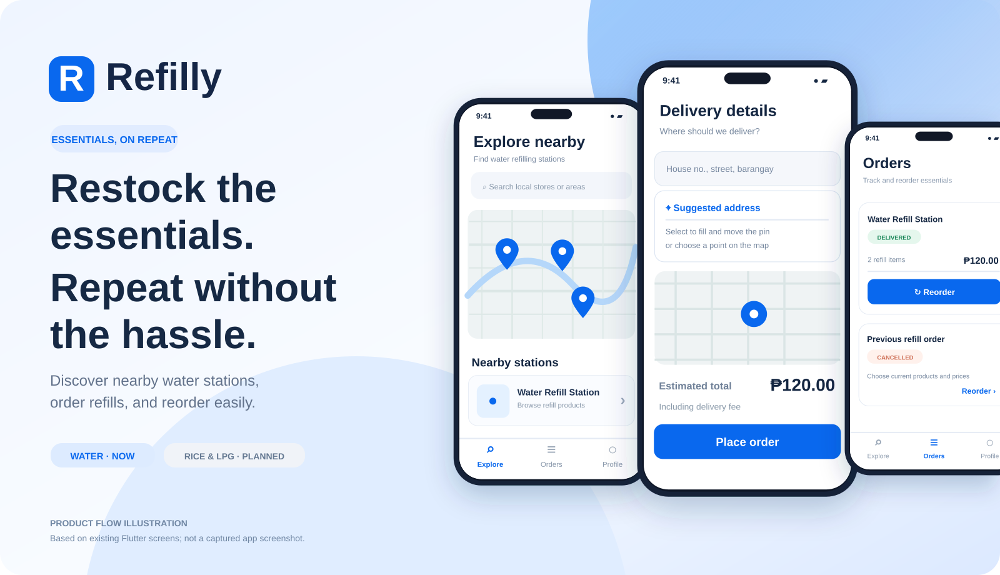
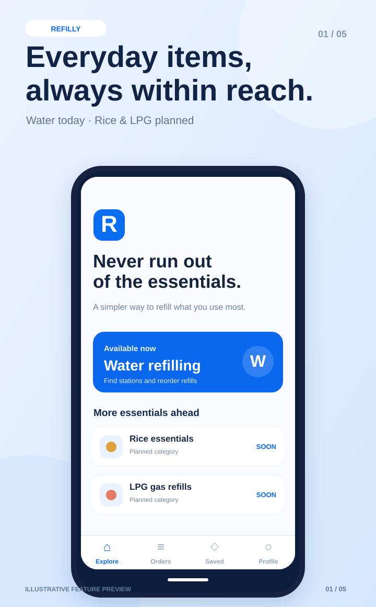
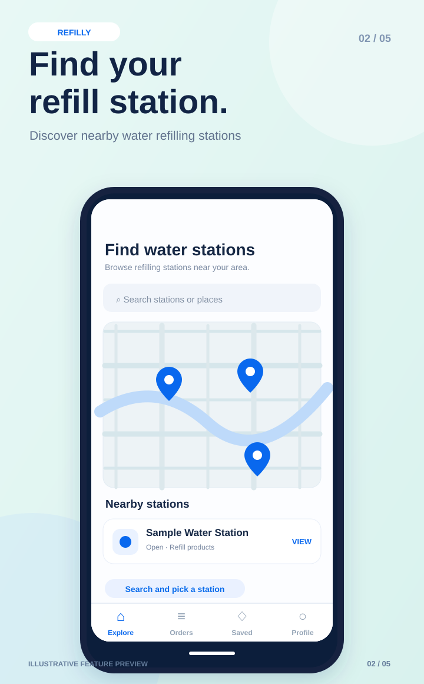
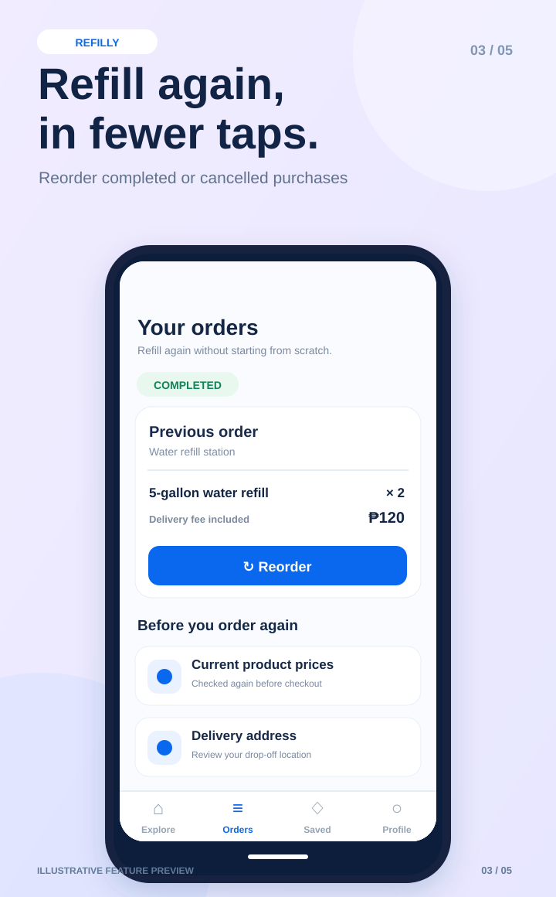
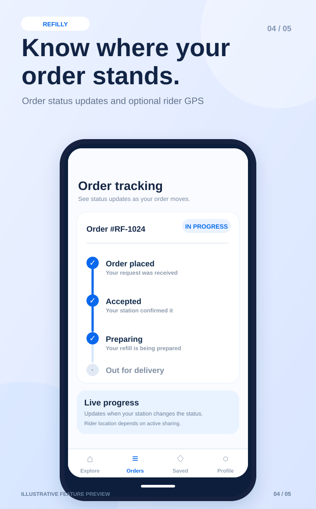
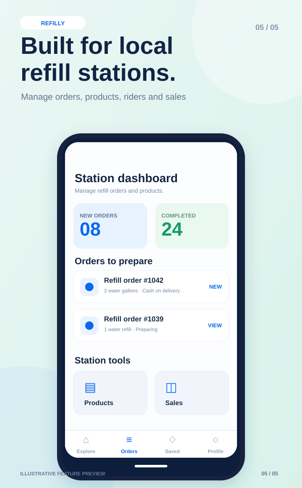

<div align="center">
  

  # Refilly

  **Restock the essentials. Repeat without the hassle.**

  Discover local suppliers for the household essentials you buy again and again.

  **Water refills available first · Rice & LPG gas planned**

  [Features](#what-refilly-does) · [Preview](#product-preview) · [Setup](#run-locally) · [Roadmap](#refill-focused-roadmap)
</div>

---

## What is Refilly?

Refilly is a **repeat-essentials ordering platform**, built around everyday replenishment. Think **water refills, rice, and LPG gas**—products households need on a regular basis.

It is **not** intended to be a general-purpose delivery, food-ordering, or courier app. Delivery is part of fulfilling an essentials order; **easy ordering and reordering are the core experience**.

> **Current launch scope:** Water refilling stations and water products. **Rice and LPG gas are future categories**, not available to order yet. Automated recurring subscriptions and scheduled deliveries are also not implemented.

## Product preview

<div align="center">
  <a href="docs/showcase/refilly-product-mockup.webp">
    
  </a>
</div>

<p align="center"><sub>Product concept supplied for Refilly branding. It includes illustrative screens and sample details, not actual screenshots. Water refilling is available first; rice and LPG are planned.</sub></p>

### Feature-flow illustration

<div align="center">
  <a href="docs/showcase/refilly-product-overview.svg">
    
  </a>
</div>

<sub>Conceptual product mockup based on existing Flutter flows; **not an actual screenshot**. Water refilling is the current category. Rice and LPG gas are planned.</sub>

## Feature showcase

<div align="center">
  
  
  
  
</div>

<div align="center">
  
</div>

<sub>**Design previews:** App Store–style illustrations of product flows, **not literal screenshots or a guarantee of current UI appearance**. Sample names, amounts, and counts are illustrative. The app currently supports water refilling; rice and LPG are planned.</sub>

## What Refilly does

### For customers

- **Discover nearby water refilling stations** on an OpenStreetMap-powered map.
- **Browse refill products** and place an order with a confirmed drop-off pin and delivery-area validation.
- **Review transparent pricing**, including station-configured delivery fees, before confirming Cash on Delivery (COD).
- **Reorder essentials** from a delivered or cancelled order. The new cart checks current product availability and prices before checkout.
- **Follow order updates**, view the in-app notification inbox, and see rider location only when a rider is actively sharing it.
- **Review delivered orders**, verify a phone number through configured OTP, or apply to run a station.
- **First-launch onboarding** for new visitors, with Skip and Get Started controls.

### For station owners

- Manage refill products, availability, prices, coverage radius, and delivery fees.
- Accept, prepare, reject, and manage orders.
- Assign a rider via a private, time-limited delivery link and confirm COD collection.
- See sales reporting, order notifications, and switch between existing owned stations.

### For riders and admins

- **Riders:** Open a private delivery link without creating an account, update delivery status, and optionally share foreground location.
- **Admins:** Review business documents and approve or reject station-owner applications.

## Current availability vs. roadmap

| Capability | Status |
| --- | --- |
| Water refilling stations and water products | ✅ Implemented in app code |
| Cash on Delivery checkout | ✅ Implemented in app code |
| Reorder from completed/cancelled orders | ✅ Implemented in app code |
| Station coverage checks and delivery fees | ✅ Implemented in app code; database migrations required |
| Owner dashboard and order management | ✅ Implemented in app code |
| Order updates and in-app notification inbox | ✅ Implemented in app code |
| Rice ordering | 🗓️ Planned |
| LPG gas ordering | 🗓️ Planned |
| Automatic scheduled refills / subscriptions | 🗓️ Planned |
| GCash and Maya payments | 🗓️ Not enabled; requires verified payment processing |
| Push notifications | 🗓️ Not integrated; in-app notifications are available |

**Note:** “Implemented in app code” is not a claim that live Supabase migrations, provider settings, or production deployment have been verified. Rider GPS updates are foreground-dependent; a road-routing ETA is not integrated.

## Technology

- **Client:** Flutter (iOS, Android, and web) · Dart · Material 3
- **Backend:** Supabase Auth, PostgreSQL, Row Level Security, Realtime, and Storage
- **Map and location:** `flutter_map`, OpenStreetMap tiles, `geolocator`
- **Other:** `fl_chart` sales reporting and an address-search/geocoding integration

## Automatic web deployment

Every push to `main` starts [Deploy Flutter web to GitHub Pages](.github/workflows/deploy-pages.yml). The workflow runs `flutter analyze` and `flutter test`, builds the production site with the `/Refilly/` base path, and publishes the result to:

**https://junmarkchi97.github.io/Refilly/**

**One-time GitHub setup required:**

1. In **Settings → Pages → Build and deployment**, select **GitHub Actions** as the source.
2. In **Settings → Secrets and variables → Actions**, create the **repository variable** `SUPABASE_URL` containing your Supabase project HTTPS URL.
3. Create the **repository secret** `SUPABASE_ANON_KEY` containing your **publishable/anon** key (never your Supabase `service_role` key).
4. In the Actions tab, rerun the deployment workflow (or push another commit).

A missing production configuration intentionally **fails the deployment** rather than publishing a broken app. GitHub Pages serves a publicly downloadable Flutter web build, so the publishable key is included in the client application; database access must continue to be protected by Supabase Row Level Security. Never use a service-role key in the browser.

**Note:** The build workflow publishes only the Flutter website. Supabase database migrations and native mobile app-store releases remain separate deployments. If iOS Safari shows an older PWA, refresh the site or remove and re-add the home-screen shortcut.

## Run locally

1. [Install Flutter](https://docs.flutter.dev/get-started/install) (3.35+).
2. Create a [Supabase](https://supabase.com) project.
3. Apply **all** files in `supabase/migrations/` in filename order. With the Supabase CLI linked to your project, use:

   ```bash
   supabase link --project-ref YOUR_PROJECT_REF
   supabase db push
   ```

   Apply the optional `supabase/seed.sql` only when sample data is wanted. **Test migration changes on staging before applying them to production.** GitHub Actions does not automatically deploy database changes.
4. Copy the sample environment file and enter your Supabase project URL and publishable/anon key:

   ```bash
   cp env.example.json env.json
   flutter pub get
   ```

5. Run Refilly:

   ```bash
   flutter run --dart-define-from-file=env.json
   flutter run -d chrome --dart-define-from-file=env.json
   flutter build web --dart-define-from-file=env.json
   ```

6. For test users, configure the Supabase Email and Phone auth settings appropriate to your environment. Phone OTP requires a working SMS integration. The optional `app_config.require_phone_verification` gate is enforced server-side when enabled.
7. Set `APP_URL` in `env.json` to your hosted Flutter web origin so private rider links point to the correct application.

**Typical development flow:** Sign up as a customer → apply to operate a water refilling station → admin approves → owner publishes products → customer orders or reorders → owner assigns a rider → rider fulfills the order.

## Automatic web deployment (GitHub Pages)

Every push to `main` now triggers [Deploy Flutter web to GitHub Pages](.github/workflows/deploy-pages.yml). It installs dependencies, runs `flutter analyze` and `flutter test`, builds a production Flutter web bundle, and publishes **only if all steps pass**. It can also be run manually using **Actions → Deploy Flutter web to GitHub Pages → Run workflow**.

**One-time setup is required before automatic deployment can succeed:**

1. Open **[Refilly → Settings → Secrets and variables → Actions](https://github.com/Junmarkchi97/Refilly/settings/secrets/actions)**.
2. Under **Variables**, create `SUPABASE_URL` with your Supabase **Project URL** (for example `https://PROJECT_REF.supabase.co`). Use a repository variable—not a secret—for this non-sensitive URL.
3. Under **Secrets**, create `SUPABASE_ANON_KEY` with the project's **publishable/anon key**, suitable for a browser application. **Never use a Supabase service-role or secret key**: Flutter web embeds the configured value in its public JavaScript.
4. Open **[Settings → Pages](https://github.com/Junmarkchi97/Refilly/settings/pages)** and select **Build and deployment → Source → GitHub Actions**.
5. Run the workflow once from the Actions tab, or push the next commit to `main`. Confirm both **Validate and build Flutter web** and **Publish website** succeed.

**Expected GitHub Pages URL:** https://junmarkchi97.github.io/Refilly/ — note the `/Refilly/` suffix. A separate site at `https://junmarkchi97.github.io/` is **not** updated by this repository's deployment workflow. Changing the root website requires configuring its actual hosting source.

**Important:** Web deployments and Supabase database migrations are separate operations; this workflow does **not** automatically apply migrations. Deployment builds use a `/Refilly/` base path, disable Flutter's legacy PWA service worker to reduce stale cached releases, and set the production app URL for private rider links. Existing browser caches may still require a refresh after the first switch.

## Data model and security

The schema includes `profiles`, `owner_applications`, `stations`, `categories`, `products`, `orders`, `order_items`, `station_reviews`, `user_notifications`, `order_rider_links`, `rider_locations`, and `app_config`.

Order creation uses the `place_order` RPC so product prices and delivery fees are calculated by the database rather than accepted from client-supplied totals. Rider actions use token-checked RPCs; owner approval, status changes, COD collection, and reviews have server-side guards.

## Refill-focused roadmap

The long-term direction is **replenishment of essentials**, not open-ended parcel delivery:

1. Expand product and seller flows for **rice** and **LPG gas**, with category-specific units, safety requirements, and fulfillment rules.
2. Offer convenient **scheduled repeat orders and reminders**, with clear customer control over each purchase.
3. Add verified digital payment options and push notifications once the required provider integrations are deployed.
4. Continue improving search, delivery coverage, order reliability, and station management.

---

<div align="center">

**Refilly — what you need, again and again.**

[Repository](https://github.com/Junmarkchi97/Refilly) · [Flutter checks](https://github.com/Junmarkchi97/Refilly/actions)

</div>
