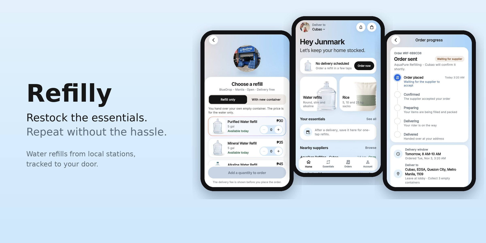
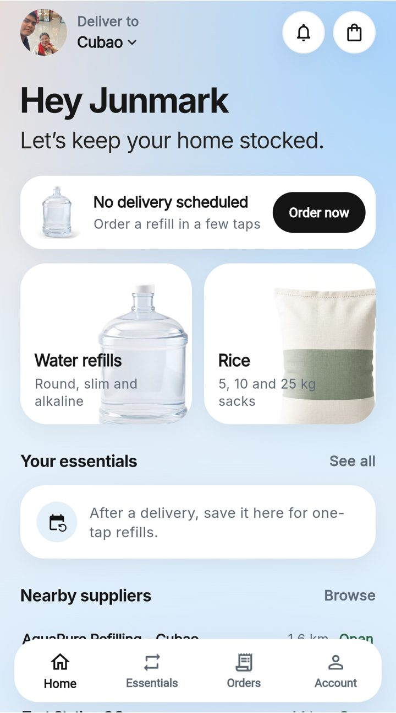
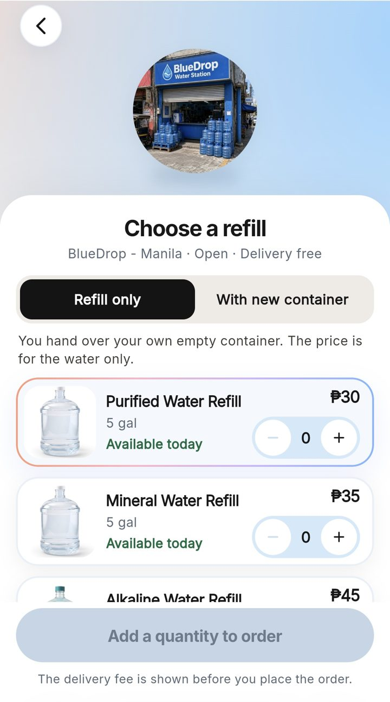
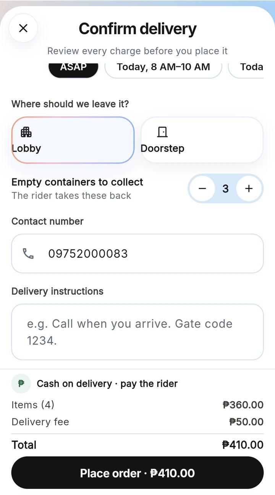
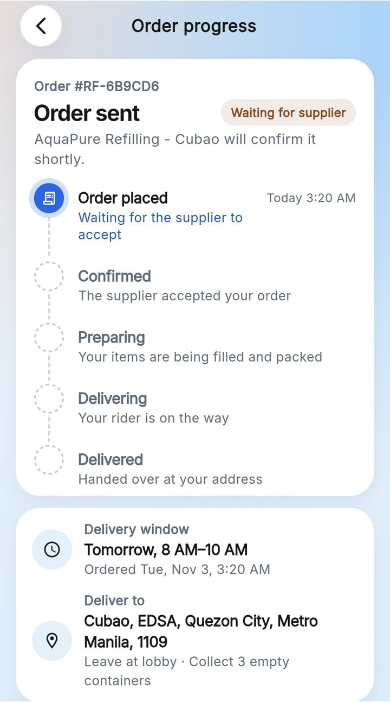
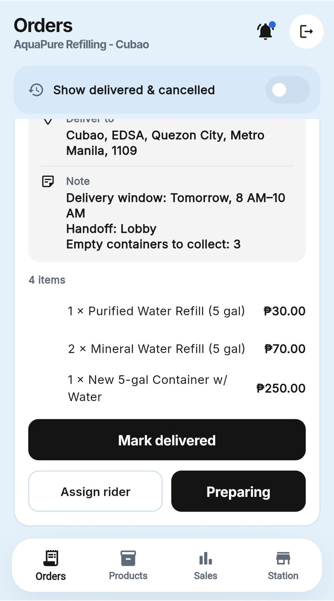
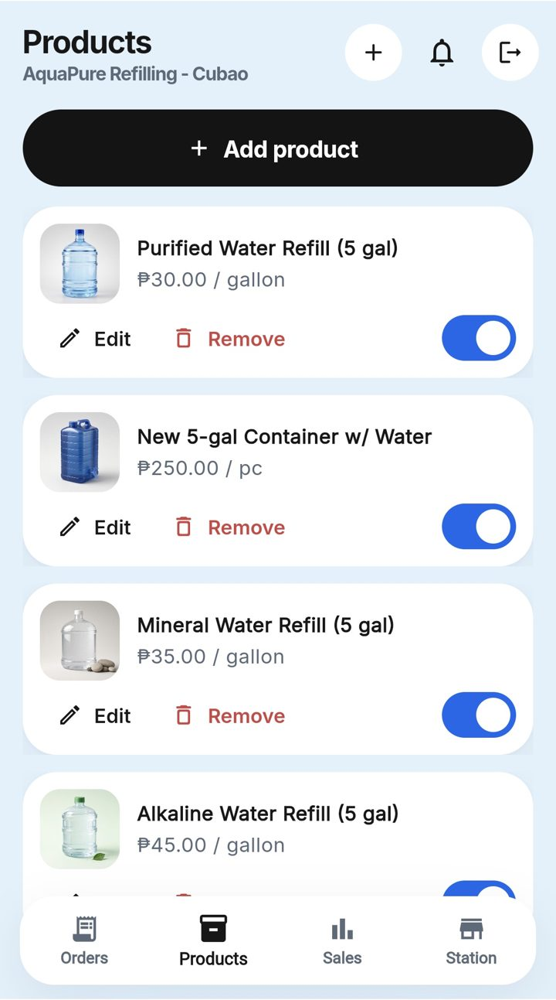
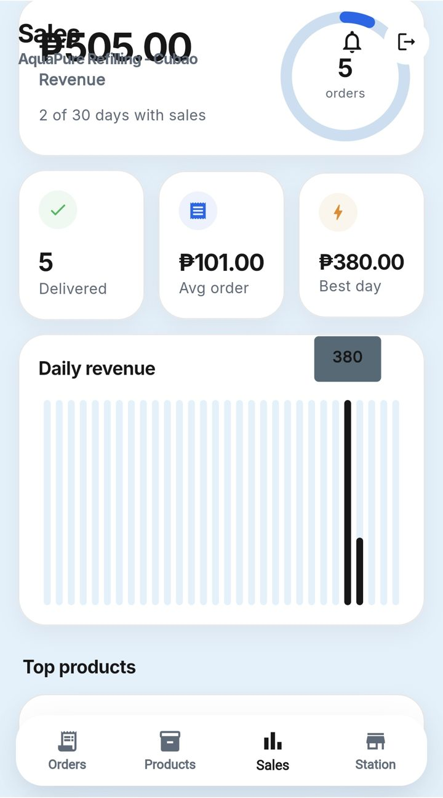
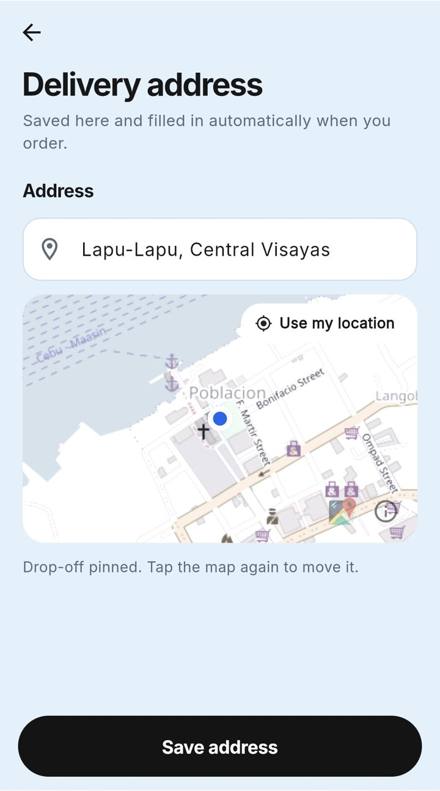

<div align="center">
  

  # Refilly

  **Restock the essentials. Repeat without the hassle.**

  Order water refills from local refilling stations, track them to your door, and reorder in a few taps.

  [Try the web app](https://junmarkchi97.github.io/Refilly/) · [The problem](#the-problem) · [Screenshots](#screenshots) · [Run locally](#run-locally)
</div>

<p align="center">
  
</p>

<p align="center"><sub>Mockup built from real screenshots of the current app.</sub></p>

---

## What is Refilly?

Refilly is a mobile and web app for ordering the **household essentials you buy again and again**, starting with **water refills**. Customers find nearby water refilling stations, choose a refill (bring your own container or get a new one), pay cash on delivery, and follow the order until it reaches the door. Station owners get a simple dashboard for orders, products, riders, and sales.

Water is live today. Rice and LPG gas are planned next.

## The problem

In many Filipino households, drinking water comes from the neighborhood refilling station. Ordering it is still mostly manual:

- **You have to message or call** the station every time, often on Messenger or by text, and wait for a reply.
- **Prices and delivery fees are unclear** until someone answers.
- **There is no way to know where your order is.** Is it confirmed? Is the rider on the way? When will it arrive?
- **Stations track orders by hand** in chats and notebooks, so orders get missed, riders get the wrong address, and cash collection is hard to reconcile.
- **Reordering the same thing every week** means repeating the whole conversation again.

## Why I built Refilly

I made Refilly to fix this. I wanted ordering a water refill to be as easy as tapping **Order now**, with clear prices up front, a delivery you can actually follow, and a one-tap reorder for next time. I also wanted small refilling stations to have a real tool to receive orders, assign riders, and see their sales, without needing a big system.

— Junmark

## How Refilly solves it

| Problem | What Refilly does |
| --- | --- |
| Messaging the station every time | Browse nearby stations and products, then order in a few taps |
| Unclear prices and fees | The total, including the delivery fee, is shown before you place the order |
| Not knowing where your order is | Live order progress: sent, confirmed, preparing, delivering, delivered |
| Wrong or vague addresses | Saved delivery address with a map pin, plus lobby or doorstep handoff notes |
| Repeating the same order | Reorder past orders and save them to **My Essentials** with refill reminders |
| Stations tracking orders by hand | Owner dashboard to accept orders, assign saved riders, share a private rider link, and view sales |

## Screenshots

All screenshots below are from the current app.

### For customers

<p align="center">
  
  
  
  
</p>

<p align="center"><sub>Home · Choose a refill · Confirm delivery · Order progress</sub></p>

### For station owners

<p align="center">
  
  
  
  
</p>

<p align="center"><sub>Orders · Products · Sales · Delivery address</sub></p>

## What Refilly does

### For customers

- **Discover nearby water refilling stations** on an OpenStreetMap-powered map.
- **Browse refill products** and place an order with a confirmed drop-off pin and delivery-area validation.
- **Review transparent pricing**, including station-configured delivery fees, before confirming Cash on Delivery (COD).
- **Reorder essentials** from a delivered or cancelled order. The new cart checks current product availability and prices before checkout.
- **Follow order updates**, view the in-app notification inbox, and see rider location only when a rider is actively sharing it.
- **Review delivered orders**, verify a phone number through configured OTP, or apply to run a station.
- **First-launch onboarding** for new visitors, with Skip and Get Started controls.

### For station owners

- Manage refill products, availability, prices, coverage radius, and delivery fees.
- Accept, prepare, reject, and manage orders.
- Assign a rider via a private, time-limited delivery link and confirm COD collection.
- See sales reporting, order notifications, and switch between existing owned stations.

### For riders and admins

- **Riders:** Open a private delivery link without creating an account, update delivery status, and optionally share foreground location.
- **Admins:** Review business documents and approve or reject station-owner applications.

## Google and Apple sign-in

Refilly supports **Google sign-in** on web, iOS and Android. **Apple sign-in is shown only on iOS**, including iOS Safari. Email and password authentication remains available.

The Flutter UI and OAuth callback handlers are implemented, but login cannot complete until **each provider is enabled and configured** in the connected Supabase project and its respective developer console.

**Supabase project:** `eregmlruwyzrziihihbt`

1. In [Supabase Authentication → Providers](https://supabase.com/dashboard/project/eregmlruwyzrziihihbt/auth/providers), enable **Google** and configure its Google Cloud OAuth credentials. Enable **Apple** and configure the Apple Developer Services ID, Team ID, Key ID, and client secret as instructed by Supabase.
2. Add this OAuth callback URL to the Google Cloud authorized redirect URIs, and use the corresponding Apple Services ID return URL: `https://eregmlruwyzrziihihbt.supabase.co/auth/v1/callback`.
3. Under [Supabase Authentication → URL Configuration](https://supabase.com/dashboard/project/eregmlruwyzrziihihbt/auth/url-configuration):
   - Set **Site URL** to `https://junmarkchi97.github.io/Refilly` (not `http://localhost:3000`). If Site URL stays on localhost, Google sign-in on the live site will bounce back to localhost after Google.
   - Under **Redirect URLs**, add:
     - `https://junmarkchi97.github.io/Refilly/**`
     - `https://junmarkchi97.github.io/Refilly/`
     - `io.refilly.app://login-callback/**`
     - `http://localhost:**` (optional, for local `flutter run`)
4. In Apple Developer → Identifiers → your App ID `ph.refilly.refilly`, enable **Sign In with Apple**. The iOS target already includes `Runner/Runner.entitlements` with that capability. On the **iOS app**, Refilly uses the native Sign in with Apple sheet and exchanges the identity token with Supabase. On **iOS Safari / web**, it still uses the Supabase OAuth browser flow.
5. Test with a fresh Google account and Apple ID (including Apple private-relay email), and verify that Supabase creates the associated user profile automatically.

**Security:** Never commit Google client secrets, Apple private keys, or a Supabase service-role key to Flutter source code. The OAuth provider secrets belong exclusively in Supabase/developer consoles. The mobile callback scheme is declared in `ios/Runner/Info.plist` and `android/app/src/main/AndroidManifest.xml`.

## My Essentials and Refill Routine

Refilly's home screen starts with **My Essentials**, where customers can manage the everyday products they buy repeatedly:

1. After a **delivered** order, open Orders or Tracking and select **Save to My Essentials**.
2. Pick a refill frequency: **weekly (7 days), every 2 weeks (14 days), monthly (30 days), or custom (1–365 days)**.
3. View estimated refill-due dates and open the private in-app notifications inbox for reminders.
4. Choose **Refill now** to check availability, current prices and active orders, then **review the cart and check out manually**.
5. **Snooze 3 days**, **Skip this time**, change the frequency, or remove a saved routine at any time.

The routine does **not** automatically order products, collect payment, or track physical household inventory. The app claims due-date reminders only when a customer loads My Essentials; there is **no push notification or background scheduler** yet. Routine reminders are deduplicated in PostgreSQL by routine and due date; the Flutter checkout also disables duplicate taps and checks for matching active refill orders. A server-wide atomic order-idempotency guarantee is not part of this MVP.

**Required database migration:** `supabase/migrations/20261031050000_refill_routines.sql`. Apply it in environments that have not yet received the change. This migration creates a customer-private `refill_routines` table and, if needed, the RLS-protected notification inbox. It uses guarded RPCs rather than exposing write privileges to client applications.

## Current availability vs. roadmap

| Capability | Status |
| --- | --- |
| Water refilling stations and water products | ✅ Implemented in app code |
| Cash on Delivery checkout | ✅ Implemented in app code |
| Reorder from completed/cancelled orders | ✅ Implemented in app code |
| My Essentials / Refill Routine (in-app reminders) | ✅ Implemented in app code and connected Refilly database |
| Station coverage checks and delivery fees | ✅ Implemented in app code; database migrations required |
| Owner dashboard and order management | ✅ Implemented in app code |
| Order updates and in-app notification inbox | ✅ Implemented in app code |
| Rice ordering | 🗓️ Planned |
| LPG gas ordering | 🗓️ Planned |
| Automatic scheduled refills / subscriptions | 🗓️ Planned |
| GCash and Maya payments | 🗓️ Not enabled; requires verified payment processing |
| Push notifications | 🗓️ Not integrated; in-app notifications are available |

**Note:** “Implemented in app code” is not a claim that live Supabase migrations, provider settings, or production deployment have been verified. Rider GPS updates are foreground-dependent; a road-routing ETA is not integrated.

## Technology

- **Client:** Flutter (iOS, Android, and web) · Dart · Material 3
- **Backend:** Supabase Auth, PostgreSQL, Row Level Security, Realtime, and Storage
- **Map and location:** `flutter_map`, OpenStreetMap tiles, `geolocator`
- **Other:** `fl_chart` sales reporting and an address-search/geocoding integration

## Automatic web deployment

Every push to `main` starts [Deploy Flutter web to GitHub Pages](.github/workflows/deploy-pages.yml). The workflow runs `flutter analyze` and `flutter test`, builds the production site with the `/Refilly/` base path, and publishes the result to:

**https://junmarkchi97.github.io/Refilly/**

**One-time GitHub setup required:**

1. In **Settings → Pages → Build and deployment**, select **GitHub Actions** as the source.
2. In **Settings → Secrets and variables → Actions**, create the **repository variable** `SUPABASE_URL` containing your Supabase project HTTPS URL.
3. Create the **repository secret** `SUPABASE_ANON_KEY` containing your **publishable/anon** key (never your Supabase `service_role` key).
4. In the Actions tab, rerun the deployment workflow (or push another commit).

A missing production configuration intentionally **fails the deployment** rather than publishing a broken app. GitHub Pages serves a publicly downloadable Flutter web build, so the publishable key is included in the client application; database access must continue to be protected by Supabase Row Level Security. Never use a service-role key in the browser.

**Note:** The build workflow publishes only the Flutter website. Supabase database migrations and native mobile app-store releases remain separate deployments. If iOS Safari shows an older PWA, refresh the site or remove and re-add the home-screen shortcut.

## Run locally

1. [Install Flutter](https://docs.flutter.dev/get-started/install) (3.35+).
2. Create a [Supabase](https://supabase.com) project.
3. Apply **all** files in `supabase/migrations/` in filename order. With the Supabase CLI linked to your project, use:

   ```bash
   supabase link --project-ref YOUR_PROJECT_REF
   supabase db push
   ```

   Apply the optional `supabase/seed.sql` only when sample data is wanted. **Test migration changes on staging before applying them to production.** GitHub Actions does not automatically deploy database changes.
4. Copy the sample environment file and enter your Supabase project URL and publishable/anon key:

   ```bash
   cp env.example.json env.json
   flutter pub get
   ```

5. Run Refilly:

   ```bash
   flutter run --dart-define-from-file=env.json
   flutter run -d chrome --dart-define-from-file=env.json
   flutter build web --dart-define-from-file=env.json
   ```

6. For test users, configure the Supabase Email and Phone auth settings appropriate to your environment. Phone OTP requires a working SMS integration. The optional `app_config.require_phone_verification` gate is enforced server-side when enabled.
7. Set `APP_URL` in `env.json` to your hosted Flutter web origin so private rider links point to the correct application.

**Typical development flow:** Sign up as a customer → apply to operate a water refilling station → admin approves → owner publishes products → customer orders or reorders → owner assigns a rider → rider fulfills the order.

## Station owner subscriptions

**Start free trial** buys an auto-renewing subscription with Apple In-App Purchase on iPhone and Google Play Billing on Android. The store keeps the payment method. When the 7-day trial ends, Apple or Google bills that account unless the owner cancels in their store subscriptions. A voucher still skips the store. Refilly does not collect a card number.

Create the same two subscriptions before the button can charge anyone:

| Product ID | Price | Trial |
| --- | --- | --- |
| `refilly_owner_monthly` | ₱249 / month | 7 days free |
| `refilly_owner_yearly` | ₱1,793 / year | 7 days free |

Put both in one subscription group. In App Store Connect, add an introductory offer of **1 week free**. In Play Console, add an offer whose first phase is a **7-day free trial**. Local iPhone runs from Xcode use `ios/Runner/Products.storekit`, which already includes that trial.

Apply `supabase/migrations/20261103143000_owner_store_billing.sql` with the other migrations so a completed purchase is saved on the account. Apple and Google still perform the renewal charge themselves.

## Automatic web deployment (GitHub Pages)

Every push to `main` now triggers [Deploy Flutter web to GitHub Pages](.github/workflows/deploy-pages.yml). It installs dependencies, runs `flutter analyze` and `flutter test`, builds a production Flutter web bundle, and publishes **only if all steps pass**. It can also be run manually using **Actions → Deploy Flutter web to GitHub Pages → Run workflow**.

**One-time setup is required before automatic deployment can succeed:**

1. Open **[Refilly → Settings → Secrets and variables → Actions](https://github.com/Junmarkchi97/Refilly/settings/secrets/actions)**.
2. Under **Variables**, create `SUPABASE_URL` with your Supabase **Project URL** (for example `https://PROJECT_REF.supabase.co`). Use a repository variable—not a secret—for this non-sensitive URL.
3. Under **Secrets**, create `SUPABASE_ANON_KEY` with the project's **publishable/anon key**, suitable for a browser application. **Never use a Supabase service-role or secret key**: Flutter web embeds the configured value in its public JavaScript.
4. Open **[Settings → Pages](https://github.com/Junmarkchi97/Refilly/settings/pages)** and select **Build and deployment → Source → GitHub Actions**.
5. Run the workflow once from the Actions tab, or push the next commit to `main`. Confirm both **Validate and build Flutter web** and **Publish website** succeed.

**Expected GitHub Pages URL:** https://junmarkchi97.github.io/Refilly/ — note the `/Refilly/` suffix. A separate site at `https://junmarkchi97.github.io/` is **not** updated by this repository's deployment workflow. Changing the root website requires configuring its actual hosting source.

**Important:** Web deployments and Supabase database migrations are separate operations; this workflow does **not** automatically apply migrations. Deployment builds use a `/Refilly/` base path, disable Flutter's legacy PWA service worker to reduce stale cached releases, and set the production app URL for private rider links. Existing browser caches may still require a refresh after the first switch.

## Data model and security

The schema includes `profiles`, `owner_applications`, `stations`, `categories`, `products`, `orders`, `order_items`, `station_reviews`, `user_notifications`, `order_rider_links`, `rider_locations`, and `app_config`.

Order creation uses the `place_order` RPC so product prices and delivery fees are calculated by the database rather than accepted from client-supplied totals. Rider actions use token-checked RPCs; owner approval, status changes, COD collection, and reviews have server-side guards.

## Refill-focused roadmap

The long-term direction is **replenishment of essentials**, not open-ended parcel delivery:

1. Expand product and seller flows for **rice** and **LPG gas**, with category-specific units, safety requirements, and fulfillment rules.
2. Offer convenient **scheduled repeat orders and reminders**, with clear customer control over each purchase.
3. Add verified digital payment options and push notifications once the required provider integrations are deployed.
4. Continue improving search, delivery coverage, order reliability, and station management.

---

<div align="center">

**Refilly — what you need, again and again.**

[Repository](https://github.com/Junmarkchi97/Refilly) · [Flutter checks](https://github.com/Junmarkchi97/Refilly/actions)

</div>
